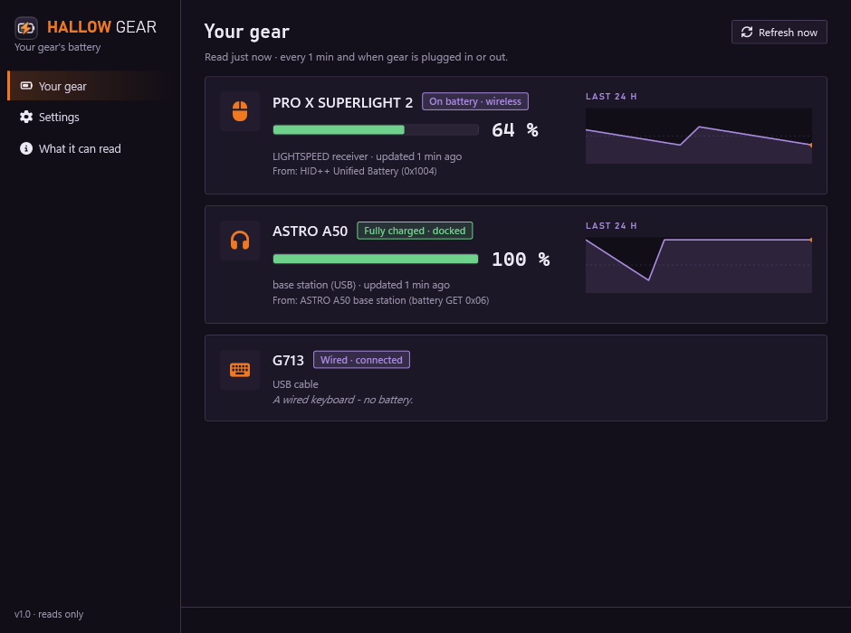
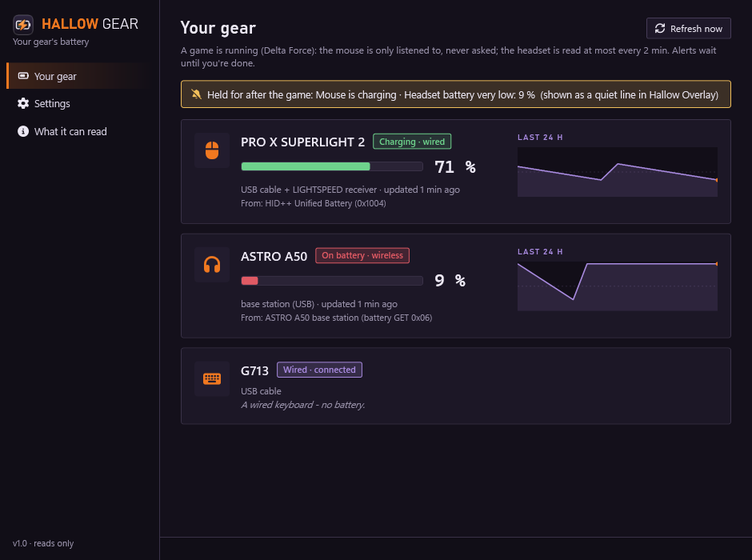
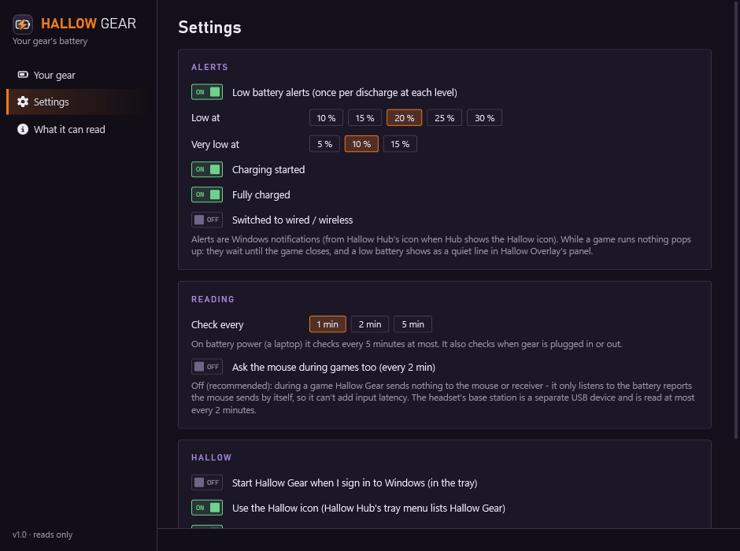

# Hallow Gear

**Battery, charging and wired / wireless for your Logitech gear - read-only.**

Part of the Hallow family of Windows apps. Hallow Gear shows a card for each piece of Logitech gear - a LIGHTSPEED mouse, an
ASTRO A50 headset, a wired keyboard - with its battery, whether it's charging, full, on battery, wired or wireless, asleep or not
connected, when it was last read, and a 24-hour sparkline. It warns you when a battery gets low (once per discharge), when charging
starts and when it's full - and **never pops up during a game**: alerts wait until you're done, and a low battery shows as a quiet
line in Hallow Overlay instead. It **only reads**: it can't change a single setting on your gear. Light and dark mode.



## What it reads (and what it can't)

| Gear | What Hallow Gear reads | How |
|---|---|---|
| **LIGHTSPEED mouse** (through its receiver) | Name, battery %, charging / full / discharging, external power, asleep / off, wired vs wireless | Logitech **HID++ 2.0**, the public protocol Solaar and Linux's `hid-logitech-hidpp` use: IRoot (0x0000) finds the features, Device Name (0x0005), and **Unified Battery (0x1004)** - or Battery Status (0x1000), or Battery Voltage (0x1001, then the percent is an estimate from the voltage). Receiver slots 1-6. |
| **Mouse on its USB cable** | "Wired (charging)" | When the mouse is plugged in it also shows up as its own Logitech USB device; Hallow Gear asks it the same reads (device index 0xFF) and merges it with the receiver's card. |
| **ASTRO A50 (Gen 5)** headset | Battery %, docked (= charging) / full | The base station (USB `046d:0b1c`, interface 8, vendor page 0xFF32) answers a **battery GET** (command 0x06, no payload). This protocol is **reverse-engineered by the open-source [HeadsetControl](https://github.com/Sapd/HeadsetControl) project** (`lib/devices/logitech_astro_a50.hpp`), not published by Logitech. |
| **Wired keyboard** (G713) | Present, wired | It has no battery; its name comes from the device. |

**What it can't tell you (honestly):**
- **A50:** whether the headset itself is switched on - HeadsetControl documents no "headset connected" read, so the card shows what
  the base station answers. The **A50 X** uses a different protocol and isn't supported, nor is the Gen 4 (a different USB id).
  Chat-mix, volume, EQ, sidetone and noise gate are not read (and never set). If a base-station firmware update changes the battery
  GET, the card says "the base station didn't answer".
- **Mouse:** some older mice only report a voltage or a coarse level (critical / low / good / full) - then the percent is marked
  *estimated*. An asleep mouse can't be read: the card keeps the last value and says "Asleep".
- Wired vs wireless for the mouse is seen when it's plugged in (its own USB device appears). Whether it's charging on the cable comes
  from the mouse's own report. Not yet checked on real hardware: the mouse on its cable (it was wireless during the probe).
- Gear from other brands, Bluetooth-only Logitech devices and Logitech Bolt receivers aren't read in 1.0.

On the developer's PC (one read-only probe): the mouse (`PRO X 2`, receiver slot 1, HID++ 4) reported 66 % on battery through
Unified Battery; the A50 base station reported 26 %, off the dock; the G713 showed as a wired keyboard.

## Read-only, by construction

- Every message Hallow Gear can send is on a **fixed allow-list in the code** (`src/Hidpp.cs`, `src/A50.cs`):
  HID++ IRoot getFeature / getProtocolVersion (ping), Device Name getDeviceNameCount / getDeviceName / getDeviceType, Battery
  Status getBatteryLevelStatus / getBatteryCapability, Battery Voltage getBatteryInfo, Unified Battery getCapabilities / getStatus -
  and the A50's battery GET. That's all.
- Anything else - DPI, report rate, lighting, onboard profiles, pairing, receiver registers (HID++ 1.0 sub-ids 0x80-0x8F), host
  switching, firmware, any headset SET - **can't even be built**: the only buffer that can be written to a device is a `SafeReport`,
  and only the two allow-listed builders can make one. The tests check every one of the 65,536 x 16 HID++ feature / function pairs
  and all 256 A50 commands, and scan the compiled code to prove `WriteFile` is called from one place only and that `HidD_SetFeature`
  / `HidD_SetOutputReport` aren't used at all.
- No driver, no third-party library: Windows' own HID APIs (SetupDi, CreateFile, HidD_*, overlapped ReadFile / WriteFile).

## Next to Logitech G HUB

Hallow Gear runs alongside G HUB (`lghub_agent`) without getting in its way: devices are opened **shared**, its requests carry their
own HID++ software id (so the answers to its questions can be told apart from G HUB's), and it asks only a handful of small questions per minute. It also *listens*:
the battery reports the mouse sends by itself (and the answers G HUB gets) update the card without asking anything. It doesn't use
G HUB's local websocket (undocumented) - it doesn't need to.

## When it reads

- Every **60 s** on mains power (1, 2 or 5 min in Settings), at most every **5 min on battery** power, and when gear is **plugged in
  or out** (device arrival / removal). Below Normal priority.
- **While a game runs** (DeltaForceClient-Win64-Shipping.exe, Discovery-d.exe, or what Hallow Hub says you're playing): nothing is
  sent to the mouse or the receiver - it **only listens**, so it can't add input latency. The A50's base station (a separate USB
  device) is read at most every 2 minutes. Settings can let it ask the mouse every 2 minutes too (off by default).

## Alerts

- **Low battery** at 20 % and **very low** at 10 % (both configurable), once per discharge each (charging re-arms them).
- **Charging started** and **fully charged**; **switched to wired / wireless** (off by default).
- They're Windows notifications - from Hallow Hub's icon when Hub shows the one Hallow icon, otherwise from Hallow Gear's own.
- **During a game nothing pops up.** Alerts are held and shown when the game closes (at most three; more become one summary). A low
  battery goes to **Hallow Overlay** as a small line in its in-game panel (Overlay 1.20+ reads it from Gear's status.json; an older
  Overlay gets a short `flash`).



## Hallow family

- Pipe `HallowFamily.Gear.<user>`: `ping`, `status`, `open [devices|settings|about]`, `menu` (each device's battery, Refresh now, Low
  battery alerts, Settings), `invoke <id>`, `quit`. `HallowGear.exe --cmd "<line>"` for scripts.
- `%APPDATA%\HallowGear\status.json` (written atomically):
  ```json
  { "app":"Gear","version":"1.0","updated":"...","running":true,
    "devices":[{"kind":"mouse","name":"PRO X 2","battery":66,"state":"on-battery","wired":false,"charging":false,"full":false,
                "connected":true,"asleep":false,"estimated":false,"paused":false,"updated":"2026-11-22T09:38:55"}],
    "lowAt":20,"veryLowAt":10,"low":[],"game":null,"polling":"normal","held":0,"alert":null,
    "lastRead":"...","startsWithWindows":false,"look":"dark","lastCrash":null }
  ```
  `kind` = `mouse`, `headset`, `keyboard` (or another HID++ type). `state` = `charging`, `full`, `on-battery`, `wired`, `wireless`
  (connected, battery not known yet), `asleep` or `not-connected`. `battery` is null for a keyboard or while unknown. `paused` = not
  asked during a game (the value is the last one read or heard). `polling` = `normal`, `on-battery` or `game`. `alert` =
  `{"text":"Mouse battery low: 18 %","level":"low|critical","device":"mouse:pro x 2","time":"..."}` only while a game runs and a
  low-battery alert is being held (for Hallow Overlay). Device names are model names (nothing private).
- Hallow Hub's tray menu lists it (one Hallow icon), the Hallow accent, light / dark (theme.json `mode`, or Settings > Look),
  crash reports kept on this PC, updates from GitHub (checked against GitHub's SHA-256), `--tray`, and **Start when I sign in to
  Windows** (per user, no admin; off by default).



## Install

1. Download **Hallow.Gear.zip** from the [latest release](https://github.com/Dom428/hallow-gear/releases/latest).
2. Right-click the zip > Properties > tick **Unblock** > OK, then Extract All.
3. Double-click **INSTALL.bat** (no admin needed). It goes to `%LOCALAPPDATA%\Programs\Hallow Gear`.

Windows notifications need to be allowed for Hallow Gear (or Hallow Hub) in Settings > System > Notifications.

## Build

`.\build.ps1` builds `HallowGear.exe` with the C# compiler that ships with Windows (.NET Framework 4.8). `.\build.ps1 -Tests` also
builds `tests\GearTests.exe`: HID++ and A50 message building / parsing from fixture bytes, the allow-lists, a fake HID++ mouse, the
battery state machine and alert rules (once per discharge, the game hold), history, light / dark contrast, and the family pipe of
a test copy with made-up gear. No test opens a real device. `HallowGear.exe --snap <folder>` renders every page off-screen with
made-up gear, dark and light. `HallowGear.exe --probe <log>` is a one-shot read-only probe of the real gear (names and battery;
it refuses while a game runs).

## Credits

- Logitech HID++ 2.0: Logitech's published feature documents, [Solaar](https://pwr-solaar.github.io/Solaar/) and Linux's
  `hid-logitech-hidpp` (the voltage-to-percent table comes from there).
- ASTRO A50 Gen 5 battery query: [HeadsetControl](https://github.com/Sapd/HeadsetControl) (reverse-engineered there).
- Icons: Font Awesome Free 7.3.1 by Fonticons, Inc. (https://fontawesome.com), licensed CC BY 4.0 - see FontAwesome-LICENSE.txt.
- Not affiliated with Logitech. Logitech, LIGHTSPEED, G HUB and ASTRO are trademarks of Logitech.
