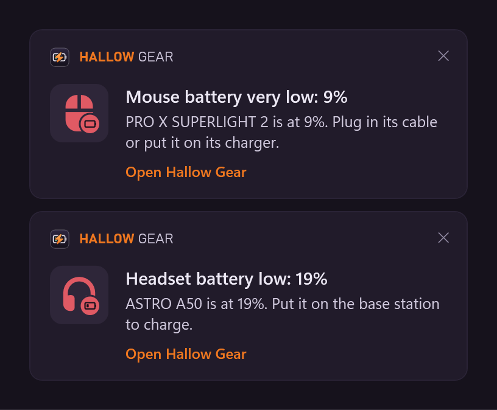
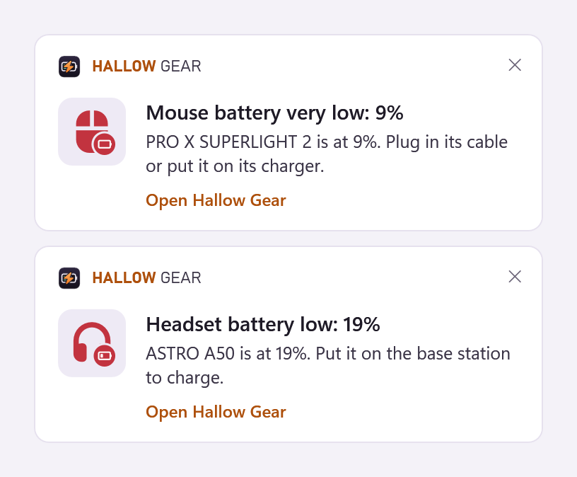
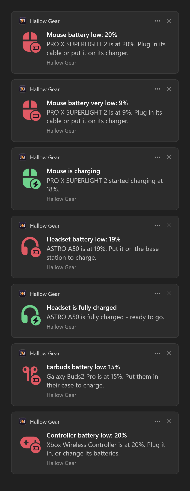

# Hallow Gear

**Battery, charging and wired / wireless for your Logitech gear and your Bluetooth devices - read-only.**

Part of the Hallow family of Windows apps. Hallow Gear shows a card for each piece of gear - a LIGHTSPEED mouse, an ASTRO A50
headset, a Logitech keyboard, and (new in 1.1) Bluetooth earbuds, headsets and controllers - with its battery, whether it's charging,
full, on battery, wired or wireless, asleep or not connected, when it was last read or seen, and a 24-hour sparkline. It warns you
when a battery gets low (once per discharge), when charging starts and when it's full. While you game, **you choose** what each alert
does: wait until you're done, a quiet line in Hallow Overlay, Gear's own small pop-up **on another monitor** that never takes focus
from the game, or a Windows notification anyway - with its own sound settings for in and out of games (new in 1.3). Started in the
middle of a game, it still shows every paired device at once and remembers your gear between restarts (1.3.1). It **only
reads**: it can't change a single setting on your gear. Light and dark mode. Its notifications show **the device's own icon** - a
mouse, a headset, earbuds, a controller - in red when the battery is low and in green when it's charging or full.

**New in 1.4:** a cleaner, calmer look matching Hallow Hub 2.28 - text tabs on top, calm cards without outlines, the battery as a
slim bar with the charging state beside the name, quiet choice chips in Settings, a calmer pop-up, slim scroll bars and a slim status
bar, in light and dark mode. Nothing it does has changed.


## Supported devices

| | Devices |
|---|---|
| **Tested on real hardware** | Logitech **PRO X 2** (LIGHTSPEED mouse), **ASTRO A50 Gen 5** (base station), **G713** (wired keyboard) |
| **Expected to work** (same reads, not tried on real hardware) | Other **Logitech HID++ 2.0** wireless devices - mice, keyboards, headsets - on any **LIGHTSPEED, Unifying or Bolt** receiver slot (1-6), on their own USB cable, or connected straight over Bluetooth. **Bluetooth devices that report their battery to Windows** (the percent you see in Settings > Bluetooth & devices): earbuds, headsets, controllers, keyboards, mice. |
| **Not supported** | Other brands' 2.4 GHz dongles (**Razer, SteelSeries, Corsair**...) - each has its own protocol. **ASTRO A50 Gen 4** and **A50 X** - different USB ids and protocols. Bluetooth devices that don't tell Windows their battery (most speakers, phones, PCs). |

**Firmware updates are left to G HUB on purpose.** Hallow Gear never writes to a device - not a setting, not a firmware block, not
even a Bluetooth notification switch - so updating firmware stays with Logitech's own app.

## What it reads (and what it can't)

| Gear | What Hallow Gear reads | How |
|---|---|---|
| **Logitech wireless device on a receiver** (LIGHTSPEED, Unifying, Bolt) | Name, type (mouse, keyboard, headset...), battery %, charging / full / discharging, external power, asleep / off | Logitech **HID++ 2.0**, the public protocol Solaar and Linux's `hid-logitech-hidpp` use: IRoot (0x0000) finds the features, Device Name (0x0005: name and type), and **Unified Battery (0x1004)** - or Battery Status (0x1000), or Battery Voltage (0x1001, then the percent is an estimate from the voltage). Every receiver slot 1-6 gets its own card, of its own kind. |
| **Logitech device on its USB cable or on Bluetooth** | "Wired (charging)", or its battery over Bluetooth | A device plugged in by cable also shows up as its own Logitech USB device; one connected straight over Bluetooth shows up as a Bluetooth HID device. Hallow Gear asks either the same reads (device index 0xFF); a cable is merged with the receiver's card. |
| **ASTRO A50 (Gen 5)** headset | Battery %, docked (= charging) / full | The base station (USB `046d:0b1c`, interface 8, vendor page 0xFF32) answers a **battery GET** (command 0x06, no payload). This protocol is **reverse-engineered by the open-source [HeadsetControl](https://github.com/Sapd/HeadsetControl) project** (`lib/devices/logitech_astro_a50.hpp`), not published by Logitech. |
| **Wired keyboard** (G713) | Present, wired | It has no battery; its name comes from the device. |
| **Bluetooth devices** (1.1) | Name, kind (earbuds, headset, controller, keyboard, mouse, other), battery %, connected / not connected, last seen | **Classic Bluetooth** (earbuds, headsets): the battery Windows already keeps on the device - the property `DEVPKEY_Bluetooth_Battery` `{104EA319-6EE2-4701-BD47-8DDBF425BBE5} 2`, read with SetupAPI. **Bluetooth LE** with the standard **Battery Service (0x180F / Battery Level 0x2A19)** when Windows has no battery property for it: Windows' Bluetooth API (WinRT `Windows.Devices.Bluetooth`). The kind comes from the device's class (classic) or appearance (LE), and the name tells earbuds from headphones. |

**What it can't tell you (honestly):**
- **A50:** whether the headset itself is switched on - HeadsetControl documents no "headset connected" read, so the card shows what
  the base station answers. The **A50 X** uses a different protocol and isn't supported, nor is the Gen 4 (a different USB id).
  Chat-mix, volume, EQ, sidetone and noise gate are not read (and never set). If a base-station firmware update changes the battery
  GET, the card says "the base station didn't answer".
- **Mouse:** some older mice only report a voltage or a coarse level (critical / low / good / full) - then the percent is marked
  *estimated*. An asleep mouse can't be read: the card keeps the last value and says "Asleep".
- Wired vs wireless for the mouse is seen when it's plugged in (its own USB device appears). Whether it's charging on the cable comes
  from the mouse's own report. Not yet checked on real hardware: the mouse on its cable (it was wireless during the probe).
- **Bluetooth:** charging is **never shown** - neither Windows' battery property nor the LE Battery Level reports it, and Hallow Gear
  doesn't guess. A device that's paired but not connected shows the last battery Windows heard and when it was last seen. Only
  **paired** devices are looked at; a live read happens only while a device is connected (otherwise Windows' cached value), so
  nothing is ever connected or paired and no prompt can appear. Battery notifications are only **listened to**: Hallow Gear doesn't
  write the notification switch (the CCCD) itself, because that's a write to the device - it hears the notifications the device
  already sends (Windows subscribes to the battery of most LE devices). The Bluetooth code is built from Windows' documented APIs and
  tested with made-up devices; **it hasn't met a real Bluetooth device yet** - the developer's PC has none paired (see below).
- Other Logitech HID++ 2.0 devices (a second mouse, a wireless keyboard, a Bolt or Unifying receiver, a Logitech device on
  Bluetooth) use the same reads as the tested PRO X 2 and are tested with made-up devices, not real ones.

On the developer's PC (read-only probes): the mouse (`PRO X 2`, receiver slot 1, HID++ 4) reported 66% on battery through
Unified Battery; the A50 base station reported 26%, off the dock; the G713 showed as a wired keyboard. The 1.1 probe found **no
paired Bluetooth devices** on that PC (no classic or LE device nodes, nothing in Windows' paired lists) - so there was no Bluetooth
battery to read.

## Read-only, by construction

- Every message Hallow Gear can send is on a **fixed allow-list in the code** (`src/Hidpp.cs`, `src/A50.cs`):
  HID++ IRoot getFeature / getProtocolVersion (ping), Device Name getDeviceNameCount / getDeviceName / getDeviceType, Battery
  Status getBatteryLevelStatus / getBatteryCapability, Battery Voltage getBatteryInfo, Unified Battery getCapabilities / getStatus -
  and the A50's battery GET. **1.3.1** adds one HID++ 1.0 *receiver* read (`SafeReport.ForReceiver`): `GET_LONG_REGISTER` of
  register 0xB5 (receiver info), sub-pages 0x20-0x25 (pairing info of slot 1-6: kind, wireless id) and 0x40-0x45 (the name the
  receiver keeps for slot 1-6), as documented by Solaar. The receiver answers it itself; nothing goes over the air. That's all.
- Anything else - DPI, report rate, lighting, onboard profiles, pairing, receiver register writes (HID++ 1.0 `SET_REGISTER` 0x80 /
  `SET_LONG_REGISTER` 0x82: the pairing lock 0xB2, notification flags...) or any other receiver register or page, host
  switching, firmware, any headset SET - **can't even be built**: the only buffer that can be written to a device is a `SafeReport`,
  and only the three allow-listed builders can make one. The tests check every one of the 65,536 x 16 HID++ feature / function pairs,
  every HID++ 1.0 sub id x register (only the 12 reads of 0xB5 pass), and all 256 A50 commands, check that each builder is called from
  one place only (`HidppDevice.Call`, `HidppReceiver.Read`, the A50 reader), and scan the compiled code to prove `WriteFile` is called from one place only and that `HidD_SetFeature`
  / `HidD_SetOutputReport` aren't used at all.
- **Bluetooth (1.1) writes nothing at all.** Device properties are read with SetupAPI's *get* functions only
  (`SetupDiGetClassDevs`, `SetupDiEnumDeviceInfo`, `SetupDiGetDeviceInstanceId`, `SetupDiGetDeviceProperty`); the only WinRT calls are
  find / open-by-id / get services / get characteristics / read value / listen for value changes. The tests scan the compiled code
  for every WinRT call and every SetupAPI / CfgMgr / Bluetooth API import: no `WriteValue`, no `WriteClientCharacteristicConfigurationDescriptor`,
  no pairing, no `MaintainConnection`, no `OpenAsync`, no `SetupDiSet*` / `CM_Set*` / `Bluetooth*` API can be called.
- No driver, no third-party library: Windows' own HID APIs (SetupDi, CreateFile, HidD_*, overlapped ReadFile / WriteFile) and
  Windows' own Bluetooth API.

## Next to Logitech G HUB

Hallow Gear runs alongside G HUB (`lghub_agent`) without getting in its way: devices are opened **shared**, its requests carry their
own HID++ software id (so the answers to its questions can be told apart from G HUB's), and it asks only a handful of small questions per minute. It also *listens*:
the battery reports the mouse sends by itself (and the answers G HUB gets) update the card without asking anything. It doesn't use
G HUB's local websocket (undocumented) - it doesn't need to.

## When it reads

- Every **60 s** on mains power (1, 2 or 5 min in Settings), at most every **5 min on battery** power, and when gear is **plugged in
  or out** (device arrival / removal). Below Normal priority.
- **While a game runs** (DeltaForceClient-Win64-Shipping.exe, Discovery-d.exe, or what Hallow Hub says you're playing): it **listens** to
  the battery reports the mouse sends by itself (and G HUB's answers). **1.3.1:** if Gear *starts* during a game it asks the
  receiver what is paired (receiver-only register reads, once) so every paired device gets a card at once - "PRO X 2 · waiting for
  its battery report (game running)" - and asks each paired device **once** for its battery: 1-2 short messages (getFeature
  Unified Battery, getStatus), nothing else. Settings > While I'm gaming > **Ask the mouse for its battery**: *once when Gear
  starts* (default) / *every 5 min* / *never*. A Gear that was already running when the game started asks the mouse nothing during
  it. The A50's base station (a separate USB device) is read at most every 2 minutes.
- **Remembered gear (1.3.1):** `%APPDATA%\HallowGear\devices.json` keeps each Logitech / A50 device's kind, name, last battery,
  last state and last seen. After a restart every device shows at once as **"last known: 66% · 12 min ago"** until fresh data
  arrives (remembered values never raise an alert). A receiver slot's battery feature is remembered too - only to *listen* to its
  reports in a later session, never to ask with it.
- **Bluetooth devices**: at most every **5 minutes** (and on Refresh), never during a game - then only the battery notifications a
  device sends by itself are heard. Settings > **Bluetooth devices** switches it all off (on by default), and each device can be
  **hidden** (no card, not in status.json, so not in Overlay either, no alerts) or have its **alerts switched off**.

## Alerts

- **Low battery** at 20% and **very low** at 10% (both configurable), once per discharge each (charging re-arms them; for a
  Bluetooth device, which doesn't report charging, the battery climbing 10 points re-arms them). The same rules for every device.
- **Charging started** and **fully charged**; **switched to wired / wireless** (off by default).
- **With the device's icon (1.2).** Real Windows notifications with the icon of the device they're about: mouse, headset, keyboard,
  earbuds, controller or other - **red** with a low-battery mark when it's low or very low, **green** with a bolt when it's charging or
  full, neutral with a plug or a signal for wired / wireless. The device cards use the same icons. Clicking a notification opens
  Hallow Gear on that device. For this Gear gives its own Start menu shortcut an AppUserModelID (`Hallow.Gear`, per user, no admin -
  only Gear's own shortcut, and only when it points at Gear). The icons are drawn by Gear (Font Awesome Free glyphs; the earbuds are
  Hallow's own) into `%LOCALAPPDATA%\HallowGear\icons` - Windows needs a file to show.
- Without that (no Start menu shortcut yet, an older Windows) it falls back to a tray balloon with the device icon as its large icon -
  from Gear's own tray icon, or Hallow Hub's when Hub shows the one Hallow icon. Each alert is shown once, one way. If you switch
  Hallow Gear's notifications off in Windows Settings, nothing is shown.
- **While I'm gaming (1.3) - your choice, per alert type:** low, very low, charging started, fully charged and wired / wireless each
  can be
  - **Hold until after the game** - nothing during the game, then shown when it closes (at most three; more become one summary). A
    low battery also shows as a small line in **Hallow Overlay**'s in-game panel (Overlay 1.20+ reads it from Gear's status.json; an
    older Overlay gets a short `flash`).
  - **Overlay line only** - just that line in Hallow Overlay, nothing after the game.
  - **Pop-up on another monitor** - Gear's own small notification (the device icon, title and text in the Hallow look, light or
    dark). It **never takes focus**: `WS_EX_NOACTIVATE | WS_EX_TOOLWINDOW | WS_EX_TOPMOST`, shown with `SW_SHOWNOACTIVATE`, clicks
    answered with `MA_NOACTIVATE`, nothing in it can take keyboard focus, no taskbar button. Click it to dismiss it (the game keeps
    focus) or click **Open Hallow Gear** on purpose to open Gear. It goes to **the monitor without the game** (the game window's
    monitor is found with `MonitorFromWindow`) or a monitor you pick (**Identify** flashes each screen's number, only when you click
    it), in the corner you pick (top right by default), hides after 8 s (5 / 8 / 15 / 30), and up to three stack. It is **never on the
    game's monitor** unless you pick "Same as the game". With **one monitor** (or the chosen one unplugged) it falls back to your
    choice: the Overlay line then after the game (default), the Overlay line only, a Windows notification, or the pop-up on that screen.
  - **Windows notification anyway**.
  - Defaults: **very low = pop-up on another monitor**, everything else held until after the game (as in 1.2).
- **Per device (1.3):** each device's alerts on / off, and its own game behaviour for all its alerts or per alert type - for example
  the mouse's very low battery as a pop-up, the headset's alerts on the Overlay line only.
- **Sound (1.3):** outside games **Windows' sound** (default), the **Hallow sound** or **silent**; during games **silent** (default), a
  **quiet Hallow sound** or **Windows' sound**. Toasts carry `<audio silent="true"/>` or `ms-winsoundevent:Notification.Default`;
  the Hallow sound and the pop-up's sound are Gear's own short chime (or Windows' notification sound) played on the default audio
  device at the volume you pick (Hallow sound 40 / 70 / 100%, in-game 10 / 20 / 30 / 50%). Gear **never changes the game's or
  Windows' volume**: it makes its own samples quieter before playing them, and it imports no volume API at all (a test checks).
- Nothing is ever shown twice: a pop-up, a toast and the after-game summary each get an alert only once.








## Hallow family

- Pipe `HallowFamily.Gear.<user>`: `ping`, `status`, `open [devices|settings|about]`, `menu` (each device's battery, Refresh now, Low
  battery alerts, Settings), `invoke <id>`, `quit`, and (1.2.2) `refresh`: the same read-only queries as Refresh now, at most once every 30 s and never during a
  game; it answers `ok {"refreshing":true|false,"reason":null|"too-soon"|"game","retryIn":12,"gapSeconds":30,"lastRead":"..."}`.
  `HallowGear.exe --cmd "<line>"` for scripts.
- `%APPDATA%\HallowGear\status.json` (written atomically):
  ```json
  { "app":"Gear","version":"1.2.2","updated":"...","running":true,
    "devices":[{"id":"mouse:pro x 2","kind":"mouse","name":"PRO X 2","battery":66,"state":"on-battery","wired":false,"charging":false,"full":false,
                "connected":true,"asleep":false,"estimated":false,"paused":false,"updated":"2026-11-22T09:38:55",
                "bluetooth":false,"lastSeen":null,"alerts":true}],
    "lowAt":20,"veryLowAt":10,"low":[],"game":null,"polling":"normal","held":0,"alert":null,"bluetooth":true,"hiddenDevices":0,
    "lastRead":"...","startsWithWindows":false,"look":"dark","lastCrash":null }
  ```
  1.1 only **added** fields (`bluetooth`, `lastSeen`, `alerts` per device; `bluetooth`, `hiddenDevices` at the top) - nothing was
  renamed or removed, and the tests run Hallow Overlay 1.22's own reader over it. Hidden Bluetooth devices aren't listed.
  1.3.1 adds `lastKnown` (the values are remembered from earlier, not fresh) and `waiting` (paired, nothing heard yet during a
  game) per device and `gameAsk` (`start`, `5min`, `never`) at the top.
  `kind` = `mouse`, `headset`, `keyboard` (or another HID++ type), and for Bluetooth devices also `earbuds`, `controller`, `other`. `state` = `charging`, `full`, `on-battery`, `wired`, `wireless`
  (connected, battery not known yet), `asleep` or `not-connected`. `battery` is null for a keyboard or while unknown. `paused` = not
  asked during a game (the value is the last one read or heard). `polling` = `normal`, `on-battery` or `game`. `alert` =
  `{"text":"Mouse battery low: 18%","level":"low|critical","device":"mouse:pro x 2","time":"...","deviceName":"PRO X 2"}` only while a
  game runs and a low-battery alert is being held (for Hallow Overlay). Device names are model names (nothing private). 1.2.2 adds
  `id` per device and `deviceName` in `alert`; `device` / `id` is the device's **opaque id** - a Logitech device's model-name key, and for
  a Bluetooth device `bt-` + 12 hex digits (a salted SHA-256, the same for that device on this PC) - **never a Bluetooth address**.
- Hallow Hub's tray menu lists it (one Hallow icon), the Hallow accent, light / dark (theme.json `mode`, or Settings > Look),
  crash reports kept on this PC, updates from GitHub (checked against GitHub's SHA-256), `--tray`, and **Start when I sign in to
  Windows** (per user, no admin; off by default).


## Install

1. Download **Hallow.Gear.zip** from the [latest release](https://github.com/Dom428/hallow-gear/releases/latest).
2. Right-click the zip > Properties > tick **Unblock** > OK, then Extract All.
3. Double-click **INSTALL.bat** (no admin needed). It goes to `%LOCALAPPDATA%\Programs\Hallow Gear`.

Windows notifications need to be allowed for Hallow Gear (or Hallow Hub) in Settings > System > Notifications.

## Build

`.\build.ps1` builds `HallowGear.exe` with the C# compiler that ships with Windows (.NET Framework 4.8). `.\build.ps1 -Tests` also
builds `tests\GearTests.exe`: HID++ and A50 message building / parsing from fixture bytes, the allow-lists, a fake HID++ mouse, the
battery state machine and alert rules (once per discharge, the game hold), history, light / dark contrast, and the family pipe of
a test copy with made-up gear. 1.1 adds a fake receiver with a keyboard and a second mouse on other slots plus a Logitech mouse on
Bluetooth (through the real reading code), Bluetooth battery / property / address parsing, device kinds, Bluetooth alerts, hide /
alerts-off / the switch, a scan of the compiled code for every WinRT and SetupAPI call, and Hallow Overlay 1.22's own status reader
run over Gear's status.json. 1.2.2 adds the pipe `refresh` (started, refused when too soon, refused during a game with nothing read) and opaque Bluetooth ids (no address anywhere in status.json). 1.3 adds the game routes for every alert type x game / no game x one / two monitors x single-monitor fallback, per-device overrides, the monitor without the game on made-up layouts (side by side, left of the main one, three screens, the chosen one unplugged - never the game's), the pop-up's window styles on a hidden window that is never shown, sound choice -> toast XML, the chime's volume in its samples, no focus or volume API in the compiled code, the routes over the pipe and a `--snap` of the settings page and the pop-up. 1.3.1 adds the receiver allow-list (every HID++ 1.0 sub id x register), pairing info / names / the 0x41 notification parsed from fixture bytes, a fake LIGHTSPEED receiver started "during a game" with nothing remembered (the mouse gets its card from receiver-only reads; the gentle read is exactly 2 messages and happens once; a receiver that doesn't tell its pairings), the schedule on a made-up clock (once in a game with "once", never with "never", every 5 min with "5min", 1.0's schedule out of games unchanged), devices.json, which code builds each kind of request, and a test copy started during a game over the pipe. `tests\GearTests.exe unit` / `pipe` runs one suite. No test opens a real device, shows a window or plays a sound.
`HallowGear.exe --snap <folder>` renders every page off-screen with made-up gear, dark and light. `HallowGear.exe --probe <log>` is
a one-shot read-only probe of the real gear and the paired Bluetooth devices (names and battery; nothing kept listening; it refuses
while a game runs). `HallowGear.exe --probe-game <log>` (1.3.1) does exactly what a fresh Gear does when it starts during a game,
with nothing remembered and nothing saved: the receiver's pairing info and one gentle battery read per paired device.

## Credits

- Logitech HID++ 2.0: Logitech's published feature documents, [Solaar](https://pwr-solaar.github.io/Solaar/) and Linux's
  `hid-logitech-hidpp` (the voltage-to-percent table comes from there).
- ASTRO A50 Gen 5 battery query: [HeadsetControl](https://github.com/Sapd/HeadsetControl) (reverse-engineered there).
- Icons: Font Awesome Free 7.3.1 by Fonticons, Inc. (https://fontawesome.com), licensed CC BY 4.0 - see FontAwesome-LICENSE.txt.
  The device icons for notifications (1.2) are drawn from those glyphs; the earbuds glyph is Hallow's own.
- Not affiliated with Logitech. Logitech, LIGHTSPEED, G HUB and ASTRO are trademarks of Logitech.
